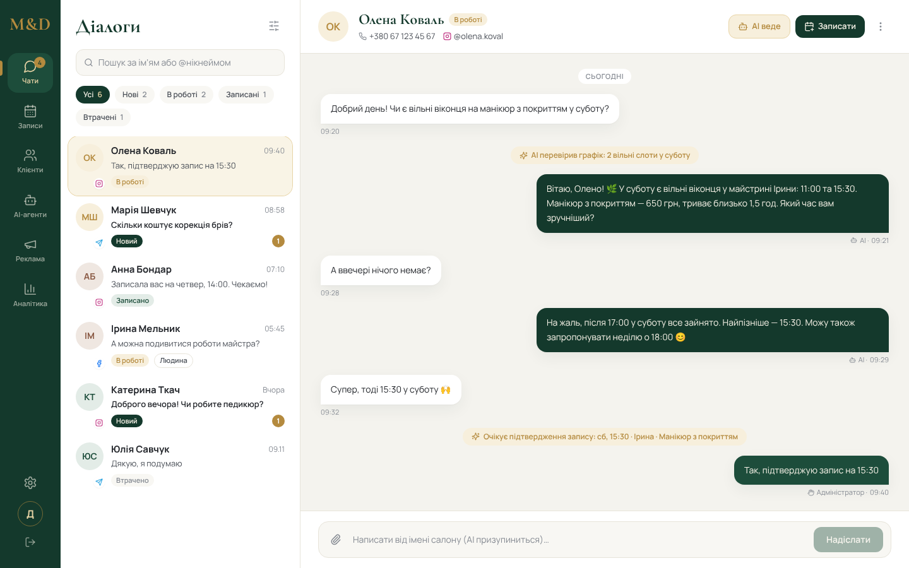

# MDs Manager — Фаза 1

Локальний AI-асистент і омніканальний диспетчер салону M&D (Windows, `D:/MDsManager/`).

**Фаза 1:** ядро бекенду (БД, вхід, налаштування, діалоги) + оболонка інтерфейсу з демо-даними.
Реальних інтеграцій Instagram/Facebook/Telegram і AI-агентів ще немає.



## Стек

| Частина | Технології |
|---|---|
| backend | Python 3.12, FastAPI, SQLAlchemy 2 (`Mapped[T]`), Alembic, SQLite (WAL), Fernet, bcrypt |
| frontend | React 18 + Vite + TypeScript, Tailwind CSS 3, Zustand, React Router, axios, lucide-react |

## Запуск (Windows, PowerShell)

### Backend

```powershell
cd D:/MDsManager/backend
python -m venv .venv
.venv\Scripts\activate
pip install -r requirements.txt
python -c "from cryptography.fernet import Fernet; print(Fernet.generate_key().decode())"
copy .env.example .env      # вставте ключ у ENCRYPTION_KEY=
alembic upgrade head
python -m app.seed          # admin@mds.local / admin   (+ --demo — 3 демо-діалоги в БД)
uvicorn app.main:app --reload
```

API: http://localhost:8000, документація: http://localhost:8000/docs.

> Не втрачайте `ENCRYPTION_KEY`: без нього секрети в `settings` і токени каналів не розшифрувати.

### Frontend

```powershell
cd D:/MDsManager/frontend
npm install
npm run dev
```

Відкрити http://localhost:5173 → вхід `admin@mds.local` / `admin`.
Vite проксіює `/api` на `localhost:8000`. Якщо бекенд не запущено, ці ж облікові дані відкривають
демо-режим (позначка внизу праворуч). Список і чат у Фазі 1 — демо-дані з `src/data/mock.ts`.

## Перевірки

```powershell
cd backend;  pytest;  ruff check .;  ruff format --check .
cd frontend; npm run build
```

## Структура

```
backend/
  app/main.py, config.py, database.py   # FastAPI, pydantic-settings, PRAGMA WAL/foreign_keys/busy_timeout
  app/models/                           # 10 таблиць: users, sessions, settings, channels, agents,
                                        #   dialogues, messages, dialog_tags, crm_clients, client_links
  app/schemas/  app/api/routes/  app/services/ (crypto, auth, dialogues, settings_store)
  alembic/versions/0001_initial.py
  seed.py → app/seed.py
  tests/                                # pytest: auth, шифрування, налаштування, діалоги
frontend/src/
  components/ pages/ api/ store/ types/ data/mock.ts lib/format.ts
data/                                   # SQLite (mds.db)
```

## API

| Метод | Шлях | Опис |
|---|---|---|
| POST | `/api/auth/login` | `{email, password}` → `{token, expires_at, user}`; 5 спроб / 15 хв на IP, далі 429 |
| GET | `/api/auth/me` | поточний користувач |
| POST | `/api/auth/refresh` | новий токен на 7 днів → `{token, expires_at}`; старий одразу недійсний, протухлий → 401 |
| POST | `/api/auth/logout` | завершити сесію |
| GET | `/api/dialogues` | фільтри: `status`, `channel`, `tag`, `q`, `limit`, `offset` |
| GET | `/api/dialogues/{uuid}/messages` | `limit`, `before_id`; кожне повідомлення має `direction`, `status`, `attachments` |
| POST | `/api/dialogues/{uuid}/messages` | `{text}` (стара назва `content` теж працює) → `201`, повідомлення `queued` у черзі вихідних; порожній текст → `400` |
| GET | `/api/media/{uuid}` | файл вкладення (без Bearer — для ``; доступ за неперебірним UUID) |
| WS | `/api/ws?token=<token>` | події в реальному часі: `new_message`, `message_status`, `dialogue_updated`; поганий токен → закриття `1008` |
| POST | `/api/settings` | `{key, value, is_secret}` — значення шифрується Fernet |
| GET | `/api/settings` | список; секрети повертаються як `null` |

Авторизація: `Authorization: Bearer <token>`.

**Черга вихідних.** Воркер перевіряє `outbound_queue` кожні `OUTBOUND_INTERVAL_SECONDS` (типово 30 с) і відправляє
через Meta-адаптер (поки `MOCK_META=true` — імітація). Невдача → повтор через 60 с × номер спроби,
після `MAX_OUTBOUND_RETRIES` (5) — `failed`. `OUTBOUND_WORKER_ENABLED=false` вимикає воркер (тести).
Один процес uvicorn (без `--workers`): черга, WebSocket і ліміт входу тримають стан у пам'яті.

**WebSocket** `/api/ws?token=…`: сервер кожні 30 с шле `{"type":"ping"}` і перевіряє, чи сесія ще чинна;
клієнт може слати `{"type":"ping"}` → `{"type":"pong"}`. Фронтенд перепідключається сам (1, 2, 4 … 30 с).

### Тестові ендпоінти (DEV only, MOCK_META=true required)

Підключаються лише при `MOCK_META=true` і `APP_ENV=development`; потрібен Bearer. У `npm run dev` є dev-панель
(кнопка з колбою внизу праворуч в інбоксі).

| Метод | Шлях | Що робить |
|---|---|---|
| POST | `/api/_test/simulate_inbound` | `{client_name, username, text, channel}` → новий клієнт + діалог + вхідне; події `new_message`, `dialogue_updated` |
| POST | `/api/_test/simulate_attachment` | `{dialogue_uuid}` → фото 1×1 до останнього вхідного (файл у `MEDIA_DIR`) |
| POST | `/api/_test/trigger_outbound_failure` | `{dialogue_uuid, text}` → вихідне з префіксом `__FAIL__`, mock його «не відправить» → повтори → `failed` |
Зміна пароля (завершує всі сесії користувача): `python -m app.set_password admin@mds.local`. Токен — `secrets.token_urlsafe(48)`, у БД лише SHA-256,
TTL 7 днів. Паролі — bcrypt. Усі часи в БД — UTC (naive datetime на вході → помилка).

## Production Deployment (Cloudflare Tunnel)

Тунель робить Manager доступним з інтернету без відкритих портів на роутері: `cloudflared` на цьому ж
комп'ютері тримає вихідне з'єднання з Cloudflare і передає запити на `http://localhost:8000`.
Frontend і API працюють з одного адреса: FastAPI сам віддає зібраний `frontend/dist`.

### Що захищає застосунок

| Захист | Як працює |
|---|---|
| Ліміт входу | `POST /api/auth/login` — 5 спроб за 15 хв з одного IP, далі `429` з `Retry-After`. IP береться з `CF-Connecting-IP`, бо за тунелем усі запити приходять з `127.0.0.1` |
| Перевірка Host | Дозволені лише `localhost`, `127.0.0.1` і домени з `ALLOWED_HOSTS`; інший `Host` → `400` |
| HTTPS | `APP_ENV=production`: запит по http → `308` на https (схему визначає `X-Forwarded-Proto` від тунелю). Звернення на `localhost` з самої машини не перенаправляються. `/docs` і `/openapi.json` вимкнено |
| Довіра до заголовків | `CF-Connecting-IP` і `X-Forwarded-Proto` враховуються лише від адрес з `TRUSTED_PROXIES` (типово `127.0.0.1,::1`, тобто cloudflared). Підробити їх ззовні не вийде |
| Cookie (на майбутнє) | `app/services/cookies.py`: `HttpOnly`, `SameSite=Lax`, `Secure` у production. Зараз сесія — токен у заголовку |

Ліміт зберігається в пам'яті процесу: запускайте **один** процес uvicorn (без `--workers`); після
перезапуску лічильники обнуляються.

### `.env` для production

```ini
APP_ENV=production
ALLOWED_HOSTS=manager.ваш-домен.com
CORS_ORIGINS=http://localhost:5173,https://manager.ваш-домен.com
```

- `APP_ENV` — `development` (http і https, `/docs` відкрито) або `production`.
- `ALLOWED_HOSTS` — точне ім'я домену тунелю без `https://` і без шляху; кілька — через кому.
  `localhost` і `127.0.0.1` додаються автоматично. Якщо забути домен, сайт відповідатиме `400`
  (а в журналі при старті буде попередження).
- `CORS_ORIGINS` — з повною схемою (`https://…`). Для роботи через тунель CORS не потрібен
  (той самий адрес), але origin домену не завадить.

### 8 кроків

1. **Змінити пароль адміністратора** — після цього `admin` / `admin` перестане працювати:
   ```powershell
   cd D:/MDsManager/backend; .venv\Scripts\activate
   python -m app.set_password admin@mds.local     # щонайменше 12 символів
   ```
2. **Зібрати frontend:**
   ```powershell
   cd D:/MDsManager/frontend; npm install; npm run build
   ```
3. **Налаштувати `D:/MDsManager/backend/.env`** — три рядки вище (`APP_ENV`, `ALLOWED_HOSTS`, `CORS_ORIGINS`),
   `alembic upgrade head`.
4. **Запустити backend лише на localhost, без `--reload`:**
   ```powershell
   uvicorn app.main:app --host 127.0.0.1 --port 8000
   ```
   Не `0.0.0.0`: тоді сервер видно лише через тунель, а не з локальної мережі.
   Перевірка: `curl http://127.0.0.1:8000/api/health` → `{"status":"ok"}`.
5. **Встановити cloudflared і увійти в Cloudflare** (домен має бути доданий у ваш акаунт Cloudflare):
   ```powershell
   winget install --id Cloudflare.cloudflared
   cloudflared tunnel login
   cloudflared tunnel create mds-manager
   ```
6. **Описати тунель** у `C:/Users/<ви>/.cloudflared/config.yml` (UUID і шлях до JSON — з виводу `create`):
   ```yaml
   tunnel: <UUID>
   credentials-file: C:/Users/<ви>/.cloudflared/<UUID>.json
   ingress:
     - hostname: manager.ваш-домен.com
       service: http://localhost:8000
     - service: http_status:404
   ```
   і прив'язати домен: `cloudflared tunnel route dns mds-manager manager.ваш-домен.com`.
   `httpHostHeader` не задавайте: застосунок має бачити справжній домен у `Host`.
7. **Запустити тунель як службу Windows** (стартує разом із системою):
   ```powershell
   cloudflared service install
   ```
   Для перевірки без служби: `cloudflared tunnel run mds-manager`.
   Backend теж варто запускати як службу (наприклад, NSSM) або через Планувальник завдань.
8. **Перевірити ззовні** (з телефона через мобільний інтернет або з іншої мережі):
   - `https://manager.ваш-домен.com` відкриває сторінку входу;
   - `http://manager.ваш-домен.com/api/health` перенаправляє на `https://`;
   - 6 невдалих входів поспіль → «Забагато спроб входу»;
   - `https://manager.ваш-домен.com/docs` не показує Swagger.

Додатково (рекомендовано): у панелі Cloudflare увімкнути **SSL/TLS → Always Use HTTPS** і закрити
домен **Cloudflare Access** (вхід за email-кодом) — тоді до сторінки входу дістануться лише ваші люди.

## Phase 1.5 — Design System (COMPLETE)

- Design tokens match MDs Connect (shared visual language): кольори, шрифти Manrope / Cormorant (локально), радіуси, тіні
- 11 reusable UI components in `frontend/src/components/ui/`
- Auth: login + 401 + idle (30 min) + refresh + logout
- Inbox: 3-column, mobile <900px, WebSocket stub ready (`frontend/src/lib/ws.ts`)

Demo page (dev only): `npm run dev` → http://localhost:5173/_demo

Підсумок змін і обмеження — [docs/REWRITE_SUMMARY.md](docs/REWRITE_SUMMARY.md).

Next: Phase 2 (real channels via Connect webhook queue)
